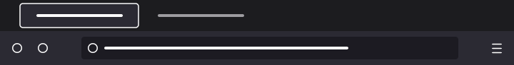

<h1 align="center">Dark by Bentendo</h1>

  The original (better) dark theme for Firefox.

  
  
  

  

## Comparison

The current Firefox dark theme takes a different approach with purple and orange accents. Dark by Bentendo brings back the classic, neutral dark appearance.

<table>
  <tr>
    <th width="50%">Official Firefox Dark</th>
    <th width="50%">Dark by Bentendo</th>
  </tr>
  <tr>
    <td align="center">
      
    </td>
    <td align="center">
      
    </td>
  </tr>
</table>

## Installation

Install Dark by Bentendo from [Firefox Add-ons](https://addons.mozilla.org/en-US/firefox/addon/firefox-dark/).

## Development

The theme is defined in `manifest.json` using Firefox's built-in theme format.

To package it, place `manifest.json` in a ZIP archive and rename the `.zip` file to `.xpi`.

---

  Copyright © 2026 Bentendo · <a href="LICENSE">All Rights Reserved</a>

